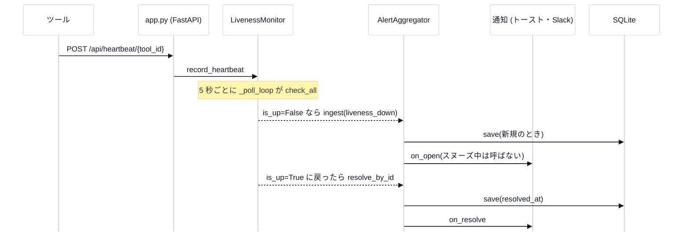

# 1. 全体像

## 何をするものか

**ツール(自作の 12 個)の生死・アラート・リポジトリの状態を 1 か所に集める、監視の中継所**です。ツールの権限は奪わず、**見るだけ**(人がボタンを押したときの `git pull` と起動だけが例外)。

## 起動すると何が動くか

`uv run hub` は、`uvicorn` で `hub.dashboard.app:app`(FastAPI)を起動します(`hub/main.py`)。`create_app()` が、部品を組み立て、**アプリの起動時に 5 つのバックグラウンドループ**を始めます(`hub/dashboard/app.py` の `_lifespan`)。

| ループ | 間隔 | 仕事 |
|---|---|---|
| `_poll_loop` | **5 秒** | 全ツールの死活監視 → down なら `ingest`、up なら `resolve_by_id` |
| `_registry_watch_loop` | **5 秒** | `registry.yaml` の更新時刻を見て、変わったら再読込(壊れていれば古いまま) |
| `_prune_loop` | **1 時間** | 解消してから **30 日**たったアラートを削除 |
| `_repo_check_loop` | **30 分** | 13 リポジトリを `git fetch`(差分の検知だけ。作業ツリーは変えない) |
| `_launch_check_loop` | **10 秒** | 各リポジトリの起動先 URL に疎通できるか(Start ボタンの「running」表示用) |

> どのループも、**例外で止まらないよう**囲んであります(1 つのツールの異常で、監視全体を止めない)。ただし、握りつぶすので**原因がログに残らない**点は既知の制約です([6 トラブルと保守](06-troubleshooting-maintenance.md))。

## 信号の流れ(受動)

アラートを**直接送る**ツール(Profiling・VRQA・Asset Data Insight)は、`POST /api/alerts/...` が `AlertAggregator` に直接つながります(死活監視は通りません)。

## 状態の置き場所

| 何を | どこに | 再起動で |
|---|---|---|
| ハートビートの受信時刻・CI 成功の時刻 | `LivenessMonitor` のメモリ(`time.monotonic()` の値) | **消える**(→ 次の信号まで「未確認」) |
| 死活監視の最新結果 | 同上 | 消える |
| スヌーズ・起動の記録 | メモリ | 消える |
| **アラートの履歴** | SQLite `.hub_state/alerts.sqlite3` | **残る** |
| ユーザー(API キーのハッシュ) | `~/.tool_orchestration_hub/auth_users.json` | 残る |
| 監査ログ | `~/.tool_orchestration_hub/audit.jsonl` | 残る |
| 計測のトレース(profiling) | `.profiling_state/traces/<target>/<runId>.json` | 残る |
| 台帳・手順書・リポジトリ一覧 | `hub/registry.yaml`・`runbooks.yaml`・`repos.yaml` | 残る(編集するデータ) |

**再起動の影響**: ハートビートの時刻が消えるので、`rpc` 系のツールは、**次のハートビートが届くまで「未確認」**に戻ります。CI 系は、**次の成功通知まで**「未確認」。アラート履歴は残ります。

## 設定(環境変数)

| 名前 | 既定 | 意味 |
|---|---|---|
| `HUB_AUTH` | `off` | `required` で API キー認証を必須にする(ユーザーが 0 人なら起動しない) |
| `HUB_AUTH_FILE` | `~/.tool_orchestration_hub/auth_users.json` | ユーザーの保存先 |
| `HUB_AUDIT_LOG` | `~/.tool_orchestration_hub/audit.jsonl` | 監査ログの出力先 |
| `HUB_ALLOWED_HOSTS` | (なし) | 127.0.0.1・localhost・::1 のほかに許可する Host(カンマ区切り) |
| `HUB_SLACK_WEBHOOK_URL` | (なし) | 設定すると Slack にも通知する |
| `HUB_CF_ACCESS_TEAM_DOMAIN` / `HUB_CF_ACCESS_AUD` | (なし) | Cloudflare Access の JWT を認証に使う |
| `HUB_API_KEY` | (なし) | `profiling_tool` の `ToolOrchestrationHubSink` が、Hub へ送るときのキー |

> 秘密(Webhook の URL・API キー)は、**環境変数**で渡し、リポジトリに書きません。

## 画面と API(要点)

| 場所 | 役割 | 最低の役割 |
|---|---|---|
| `GET /` | ダッシュボード | viewer |
| `GET /admin` | registry の再読込・リポジトリ同期(別ページ) | admin |
| `GET /api/registry`・`/api/alerts`・`/api/overview` | 読み取り | viewer |
| `POST /api/heartbeat/{id}`・`/api/ci-success/{id}`・`/api/alerts/*` | 各ツールからの信号 | operator |
| `POST /api/alerts/{id}/snooze` | 通知のスヌーズ | operator |
| `POST /api/repos/{id}/launch/{n}`・`/open-folder`・`/api/repos/check` | 起動・フォルダ・差分検知 | operator |
| `POST /api/registry/reload`・`/api/repos/{id}/sync` | 再読込・`git pull` | admin |

`HUB_AUTH=off` では、全員が admin 扱い(`ANONYMOUS`)です。
