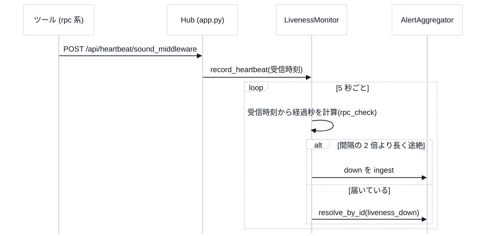

# 第 0 回 Hub とは何か(まず、全体の見取り図)

> 所要時間の目安: 1 時間 / 前提: Python の基本(関数・クラス・辞書)

## この回のゴール

- ToolOrchestrationHub(以下 **Hub**)が**何を解決し、何をしないか**を説明できる。
- **能動の確認**(こちらから聞く)と**受動の確認**(相手の合図を待つ)の違いを説明できる。
- Hub の登場人物(台帳・死活監視・アラート・ダッシュボード)の役割が分かる。
- 台帳を読み込んで、手元で数えられる。

## 1. 解きたい問題

自作のツールは、増えていきます。このリポジトリの台帳には、いま **13 個**が載っています(RAG の橋渡し・音のミドルウェア・CI で回る収集ツールなど)。
増えると、次のことが分からなくなります。

- どのツールが、**いま動いている**のか。
- 止まっているなら、**いつから**か。誰が気づくのか。
- 同じ異常で、通知が**何十回も**来ないか。

Hub は、この 3 つに答える**監視の中継所**です。ツールの出す信号(ハートビート・CI の成功・アラート)を集めて、**ひとつの画面と通知**に直します。

> **やらないこと**: ツールの中身を直す・再起動する・権限を奪うことはしません。Hub は**見るだけ**(例外: 人がボタンを押したときの起動と `git pull`)。
> Hub 自身も、**どのツールの単一障害点にもならない**(Hub が止まっても、各ツールは動き続ける)。

## 2. 登場人物

| 登場人物 | ファイル | 一言で |
|---|---|---|
| **台帳(registry)** | `hub/registry.py`・`hub/registry.yaml` | 監視する相手の一覧。どう確認するかも書く |
| **死活監視(liveness)** | `hub/health/` | 「生きているか」を判定する(3 種類) |
| **アラート** | `hub/alert_aggregator.py` | 異常を 1 件にまとめ、解消まで追う |
| **状態の判定** | `hub/tool_state.py` | 「正常・警告・停止・未確認・対象外」の 5 つに決める |
| **ダッシュボード** | `hub/dashboard/` | 画面と API(FastAPI) |
| **入口の守り** | `hub/security.py`・`auth.py`・`audit.py` | Host・Origin の検査、API キー、役割、監査ログ |

構成図(全体):


## 3. 能動と受動(いちばん大事な考え方)

「生きているか」を確かめる方法は、2 つあります。

| 方法 | たとえ | Hub での例 |
|---|---|---|
| **能動(ポーリング)** | こちらから電話をかけて、出るか見る | `http_bridge_check`: 相手の `/health` を、Hub が叩く |
| **受動(ハートビート)** | 相手が「元気です」と定期的に知らせるのを待つ | `rpc_check`・`ci_pipeline_check`: 届いた**時刻**だけを見る |

**受動の利点**は、Hub が相手に**接続を開かない**こと。相手の権限や状態に触れず、相手の都合(ファイアウォール・ソケット)を壊しません。
**欠点**は、**信号が一度も来ていない間は、生死が分からない**こと。この「分からない」を、Hub は**「未確認」**という別の状態にして、偽の「正常」を出しません(第 4 回)。



## 4. 台帳を読み込んでみる

台帳は、`registry.yaml` に書かれた**データ**です。コードを変えずに、ツールを足せます。
読み込んで、カテゴリ(Hub がどう関わるか)ごとに数えます。

```python
# 実行できる
from hub.registry import ToolCategory, ToolRegistry

registry = ToolRegistry.load()
print("台帳の件数:", len(registry.all()))
for category in ToolCategory:
    print(category.value, len(registry.by_category(category)))
print("monitored:", sorted(e.tool_id for e in registry.monitored()))
```

```text
# 出力
台帳の件数: 13
monitored 7
observed_only 5
excluded 1
monitored: ['asset_data_insight_suite', 'dev_rag_environment', 'local_llm_harness', 'profiling_tool', 'research_collector', 'the_algorithm_illustrated', 'visual_regression_qa_tool']
```

- `monitored`(Hub が**確認の仕事を持つ**)・`observed_only`(**受動だけ**。Hub からは何も開かない)・`excluded`(台帳には載せるが、監視しない)。
- `monitored` の 7 件の中にも、**能動**(`http_bridge_check`: `dev_rag_environment`・`local_llm_harness`・`profiling_tool`)と、**CI の最終成功からの経過時間だけ**(`ci_pipeline_check`: 残りの 4 件)があります。次回以降で見ます。

## 5. 読み方の地図

- 手を動かして理解する順: **台帳(第 1 回)→ 死活監視(第 2 回)→ アラート(第 3 回)→ 状態と優先度(第 4 回)→ 入口の守り(第 5 回)→ テストと総合演習(第 6 回)**。
- 保守・拡張の実務は [学習資料](../learn/index.md)。用語は [用語集](../learn/glossary.md)。

## 確認問題

1. Hub が「やらないこと」を 2 つ挙げてください。
2. 受動の確認(ハートビート)の利点と欠点を、それぞれ 1 つ挙げてください。
3. `observed_only` のツールに、Hub は能動的に接続しますか。
4. 台帳に載っているが、監視していないカテゴリは何ですか。

## 解答

1. ツールの中身を直す・再起動する・権限を奪う(人が押したときの起動と `git pull` だけは例外)。Hub 自身が単一障害点になる。
2. 利点: 相手に接続を開かず、相手の権限・状態に触れない。欠点: 信号が来るまで、生死が分からない(→「未確認」)。
3. しない。相手が送るハートビートの受信時刻を、計算するだけ。
4. `excluded`(対象外)。

## まとめ

- Hub は、点在するツールの**生死とアラートを 1 か所に集める監視の中継所**。見るだけで、ツールの権限は奪わない。
- 確認は、**能動**(Hub が聞く)と**受動**(相手の合図を待つ)。信号が無い間は「未確認」。
- 台帳(YAML)がデータで、コードは変えずにツールを足せる。次の回は、その台帳の中身と検証。
