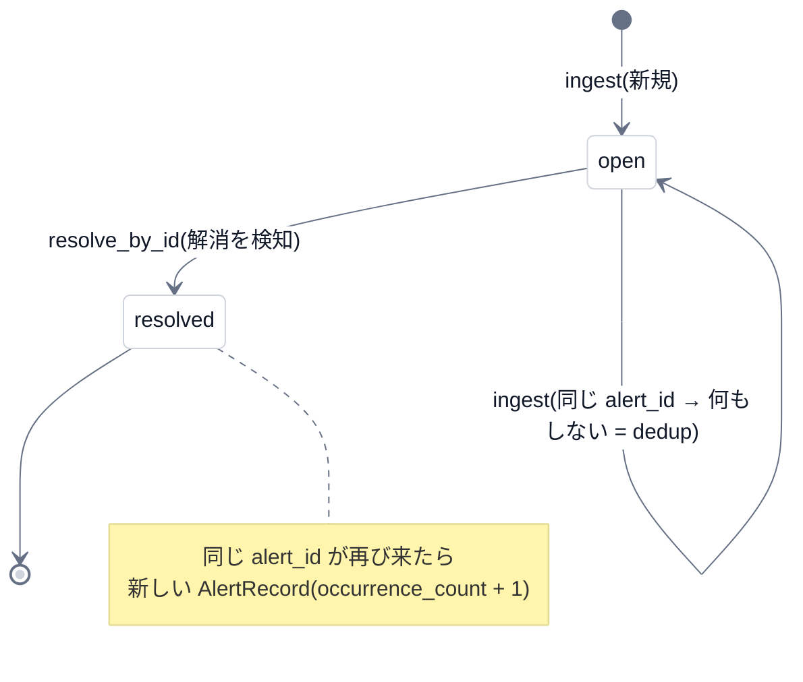

# 第 3 回 アラート: 1 件にまとめ、解消まで追う

> 所要時間の目安: 3 時間 / 前提: 第 0〜2 回

## この回のゴール

- アラートの**ライフサイクル**(open → resolved、再発)を説明できる。
- `alert_id`(重複を判定するキー)が、**どう作られ、なぜ必要か**を説明できる。
- **dedup**(同じ異常を 1 件にまとめる)と**再発**の数え方を、コードで確かめられる。
- 4 つの送り手(死活監視・Profiling・VRQA・Asset Data Insight)が、**同じ形に正規化**される理由が分かる。
- スヌーズが「通知だけ」を止め、**状態は変えない**ことを説明できる。

## 1. アラートの 1 件: `AlertRecord`

```python
# 引用: hub/alert_aggregator.py::AlertRecord
@dataclass
class AlertRecord:
    """1つのopen→resolveライフサイクル。同じalert_idが再発すると別のAlertRecordになる。"""

    alert_id: str  # sourceToolId + 正規化した障害シグネチャのハッシュ。dedupキー
    source_tool_id: str
    severity: Severity
    message: str
    first_seen_at: datetime
    resolved_at: Optional[datetime] = None  # Noneの間はopen。resolve検知でタイムスタンプを刻む
    # 同じalert_idがこれまでに何回openしたか(このレコードを含む)。再発(resolve後の再open)で増える。
    # ポーリングで同じ異常が繰り返し検知されるだけの場合(dedup)は増えない。
    occurrence_count: int = 1

    @property
    def is_open(self) -> bool:
        return self.resolved_at is None

    def is_open_at(self, at: datetime) -> bool:
        """時刻atの時点でこのアラートがopenだったか(アラート履歴の再現用)。

        開始時刻ちょうどはopen扱い、解消時刻ちょうどはresolved扱いにする(半開区間 [first_seen, resolved))。
        """
        if at < self.first_seen_at:
            return False
        return self.resolved_at is None or at < self.resolved_at
```

- `alert_id`: **「同じ異常」かを判定するキー**。`発生元のツール : 障害の署名のハッシュ`。
- `resolved_at`: `None` の間は **open(未解消)**。解消を検知したら、時刻を刻む。
- `occurrence_count`: 同じ `alert_id` が、これまでに**何回 open したか**。ポーリングで同じ異常を何度見ても増えず、**解消してから再発したときだけ**増える。
- `is_open_at(at)`: **過去の時刻**に open だったか(履歴スライダー用)。`[開始, 解消)` の**半開区間**。開始の瞬間は open、解消の瞬間は resolved。

> **1 つの AlertRecord = 1 回の「発生 → 解消」**。同じ異常が再発したら、**別の** `AlertRecord` が作られます(履歴が上書きされない)。



## 2. `alert_id`: 異常の「署名」

```python
# 引用: hub/alert_aggregator.py::_make_alert_id
def _make_alert_id(source_tool_id: str, signature: str) -> str:
    """sourceToolId + 正規化した障害シグネチャのハッシュ。"""
    digest = hashlib.sha256(signature.encode("utf-8")).hexdigest()[:16]
    return f"{source_tool_id}:{digest}"
```

- **署名(signature)**: 「どの異常か」を表す短い文字列。Profiling なら指標名、VRQA ならケース ID、死活監視なら固定の `liveness_down`。
- **ハッシュ(SHA-256)** で固定長に縮め、**先頭 16 文字**を使う。同じ署名からは**いつも同じ ID**ができる(だから dedup できる)。
- 発生元のツール ID を前に付けて、**別のツールの同名の署名と混ざらない**ようにする。

`hash()`(Python 組み込み)でなく `hashlib.sha256` を使うのは、組み込みの `hash()` が**実行のたびに値が変わる**(文字列のハッシュのランダム化)から。保存して、再起動後に同じ異常と見分けるには、**毎回同じ値**が要る。

## 3. 4 つの送り手を、同じ形にそろえる(正規化)

| 送り手 | 関数 | 署名に使う値 | 重大度の決まり方 |
|---|---|---|---|
| Hub 自身の死活監視 | `normalize_from_health_check` | 固定の `liveness_down` | down なら `critical`、up なら `info` |
| Profiling Tool | `normalize_from_profiling_tool` | `signature`(無ければ `metric_name`) | 送られた `severity`(既定 `warn`) |
| Visual Regression QA | `normalize_from_visual_regression_qa` | `case_id` | 失敗(`passed: false`)なら `critical`、成功なら `info` |
| Asset Data Insight | `normalize_from_asset_data_insight` | `asset_id` | 送られた `severity`(既定 `warn`) |

**`info` は「解消した」という信号**として使います(`hub/dashboard/app.py` の `_normalize_and_ingest`)。VRQA が「このケースは通った」と送ると、同じ署名の open アラートが resolved になります(Research-Collector が、解消時に Issue を自動でクローズするのと同じ型)。

```python
# 実行できる
from hub.alert_aggregator import (
    normalize_from_asset_data_insight,
    normalize_from_health_check,
    normalize_from_profiling_tool,
    normalize_from_visual_regression_qa,
)
from hub.health.base import HealthResult

alerts = [
    normalize_from_health_check("sound_middleware", HealthResult(is_up=False)),
    normalize_from_health_check("sound_middleware", HealthResult(is_up=True)),
    normalize_from_profiling_tool({"signature": "gpu_frame_budget_exceeded", "severity": "critical"}),
    normalize_from_visual_regression_qa({"case_id": "battle_hud_overlay", "passed": False}),
    normalize_from_visual_regression_qa({"case_id": "battle_hud_overlay", "passed": True}),
    normalize_from_asset_data_insight({"asset_id": "characters/hero_base_mesh"}),
]
for a in alerts:
    tool, digest = a.alert_id.split(":")
    print(f"{tool:26} {a.severity.value:9} ハッシュ{len(digest)}文字  {a.message}")
print("同じ署名は同じ ID:", alerts[0].alert_id == alerts[1].alert_id, "/", alerts[3].alert_id == alerts[4].alert_id)
```

```text
# 出力
sound_middleware           critical  ハッシュ16文字  sound_middleware liveness check: down
sound_middleware           info      ハッシュ16文字  sound_middleware liveness check: up
profiling_tool             critical  ハッシュ16文字  profiling alert: gpu_frame_budget_exceeded
visual_regression_qa_tool  critical  ハッシュ16文字  visual regression case battle_hud_overlay: failed
visual_regression_qa_tool  info      ハッシュ16文字  visual regression case battle_hud_overlay: passed
asset_data_insight_suite   warn      ハッシュ16文字  asset insight flagged: characters/hero_base_mesh
同じ署名は同じ ID: True / True
```

> 死活監視の「down」と「up」が**同じ `alert_id`** なのがポイントです。down で open したアラートを、up のときに `resolve_by_id` で**そのまま閉じられる**。

## 4. 取り込む(`ingest`)と閉じる(`resolve_by_id`)

```python
# 引用: hub/alert_aggregator.py::upsert_alert
def upsert_alert(new_alert: AlertRecord, existing: list[AlertRecord]) -> AlertRecord:
    """Research-Collector `refresh_auth.ps1` の
    「openなラベル一致Issueがあれば新規作成せず、解消時にcloseする」パターンを踏襲する。

    alert_idが一致するopenレコードがあれば新規作成せず、firstSeenAtは据え置いてそれを返す。
    一致するopenレコードが無ければ新規AlertRecordをそのまま返す(呼び出し側がexistingへ追加する)。
    """
    for existing_alert in existing:
        if existing_alert.alert_id == new_alert.alert_id and existing_alert.resolved_at is None:
            return existing_alert  # 重複作成しない(Research-Collectorの重複防止チェックと同型)
    return new_alert
```

`upsert` は「あれば更新、無ければ追加」。ここでは、**open な同じ `alert_id` があればそれを返し、無ければ新しいものを返す**。解消済みの同じ ID は「あった」ことにしない(だから再発は新しい 1 件になる)。

`AlertAggregator.ingest` が、その結果を使って、通知・保存・再発の数え方をまとめます。

```python
# 引用: hub/alert_aggregator.py::AlertAggregator.ingest
def ingest(self, new_alert: AlertRecord) -> AlertRecord:
    """新規アラートをdedupしつつ取り込む。既存openレコードがあればそれを返す。"""
    upserted = upsert_alert(new_alert, self._alerts)
    if upserted is new_alert:
        # 同じalert_idの過去のライフサイクル(解消済み)があれば再発。発生回数を引き継いで数える。
        prior_lifecycles = sum(1 for a in self._alerts if a.alert_id == new_alert.alert_id)
        new_alert.occurrence_count = max(new_alert.occurrence_count, prior_lifecycles + 1)
        self._alerts.append(new_alert)
        if self._store is not None:
            self._store.save(new_alert)
        if self._on_open is not None and not self.is_snoozed(new_alert.alert_id):
            self._on_open(new_alert)
    return upserted
```

- `upserted is new_alert`: **新規**のとき(同一物か `is` で比べる)。
- **新規のときだけ**、保存(`store.save`)と通知(`on_open`)が走る。**dedup されたときは、何も起きない**(同じ通知が何十回も来ない)。
- `on_open` / `on_resolve` は**コールバック**(関数を渡す)。Aggregator は、通知の実装(トースト・Slack)を**何も知らない**(疎結合)。

```python
# 実行できる
from hub.alert_aggregator import AlertAggregator, normalize_from_profiling_tool

opened, resolved = [], []
agg = AlertAggregator(on_open=lambda a: opened.append(a.alert_id), on_resolve=lambda a: resolved.append(a.alert_id))
raw = {"signature": "gpu_frame_budget_exceeded", "severity": "critical", "message": "frame budget exceeded"}

first = agg.ingest(normalize_from_profiling_tool(raw))
for _ in range(3):  # ポーリングで、同じ異常を何度も検知
    again = agg.ingest(normalize_from_profiling_tool(raw))
print("同じ 1 件にまとまった:", again is first, "/ open の数:", len(agg.open_alerts()), "/ 通知の回数:", len(opened))

agg.resolve_by_id(first.alert_id)
print("解消後: open", len(agg.open_alerts()), "/ resolved", len(agg.resolved_alerts()), "/ 解消の通知:", len(resolved))

second = agg.ingest(normalize_from_profiling_tool(raw))  # 同じ異常が再発
print("再発は別の 1 件:", second is not first, "/ 発生回数:", second.occurrence_count, "/ 全部で", len(agg.all()), "件")
print("通知の合計(open 側):", len(opened))
```

```text
# 出力
同じ 1 件にまとまった: True / open の数: 1 / 通知の回数: 1
解消後: open 0 / resolved 1 / 解消の通知: 1
再発は別の 1 件: True / 発生回数: 2 / 全部で 2 件
通知の合計(open 側): 2
```

## 5. 解消した過去を、どこまで再現できるか

`AlertRecord.is_open_at` は、**半開区間** `[first_seen_at, resolved_at)` で判定します。

```python
# 実行できる
from datetime import datetime, timedelta, timezone

from hub.alert_aggregator import AlertRecord, Severity

t0 = datetime(2026, 11, 1, 12, 0, tzinfo=timezone.utc)
alert = AlertRecord("demo:0000", "demo", Severity.WARN, "テスト", first_seen_at=t0, resolved_at=t0 + timedelta(minutes=10))

for label, minutes in [("発生の 1 分前", -1), ("発生の瞬間", 0), ("5 分後", 5), ("解消の瞬間", 10), ("解消の後", 11)]:
    print(f"{label:10}", alert.is_open_at(t0 + timedelta(minutes=minutes)))
```

```text
# 出力
発生の 1 分前   False
発生の瞬間      True
5 分後       True
解消の瞬間      False
解消の後       False
```

画面の「履歴スライダー」は、この関数で**その時刻に open だったアラート**を数え、ツールの状態を再現します。
**限界**: 履歴に残るのは**アラートの発生・解消だけ**。死活監視の結果そのもの(いつ何 ms だったか)は残らないので、Hub が止まっていた期間は再現できません(画面にも、そう注意書きがあります)。

## 6. スヌーズ: 通知だけを止める

同じアラートが短い時間に open と resolve を繰り返す(**フラッピング**)と、通知がうるさい。**スヌーズ**は、そのアラートの**通知だけ**を一時的に止めます。

```python
# 実行できる
from datetime import datetime, timedelta, timezone

from hub.alert_aggregator import AlertAggregator, normalize_from_visual_regression_qa

notified = []
agg = AlertAggregator(on_open=lambda a: notified.append(a.message))
now = datetime.now(timezone.utc)

failing = {"case_id": "battle_hud_overlay", "passed": False, "message": "pixel diff 3.4%"}
alert = normalize_from_visual_regression_qa(failing)
agg.snooze(alert.alert_id, now + timedelta(hours=1))
print("スヌーズ中?", agg.is_snoozed(alert.alert_id, now=now))

agg.ingest(alert)
print("open の数:", len(agg.open_alerts()), "/ 通知:", len(notified), "← 状態は変わるが、通知は出ない")

print("1 時間後も?", agg.is_snoozed(alert.alert_id, now=now + timedelta(hours=1, seconds=1)))
```

```text
# 出力
スヌーズ中? True
open の数: 1 / 通知: 0 ← 状態は変わるが、通知は出ない
1 時間後も? False
```

**スヌーズは、アラートの状態(open / resolved)にも、dedup にも影響しない**。表示は通常どおり。スヌーズ状態は Hub のメモリにだけ持ち、**再起動で解除**されます(永続化しない = 軽い一時状態)。

## 7. 保存と掃除

- **保存**: `AlertAggregator(store=...)` に `SqliteAlertStore` を渡すと、新規・解消のたびに保存し、**再起動後に履歴を読み戻す**(`__init__` の `store.load_all()`)。保存の形は、[学習資料](../learn/03-internals.md)。
- **掃除**: 解消してから **30 日**たったレコードを、1 時間おきに削除(`prune_resolved`)。**レコード単位**で消す: 以前は `alert_id` で消していて、同じ ID の「いま未解消の再発」まで消す不具合があった(修正済み)。

## 確認問題

1. `alert_id` に、署名のハッシュを使うのは、なぜですか。Python の `hash()` ではだめな理由も答えてください。
2. ポーリングで同じ異常を 100 回検知したとき、通知は何回出ますか。
3. 解消した異常が再発すると、`occurrence_count` はどうなりますか。
4. VRQA が `passed: true` を送ると、何が起きますか。
5. スヌーズ中のアラートが open になったとき、何が止まり、何が止まりませんか。

## 解答

1. 同じ署名から**いつも同じ ID**を作り、dedup と、再起動後の同一判定に使うため。`hash()` は実行のたびに値が変わる(ランダム化)ので、保存して比べられない。
2. **1 回**(新規のときだけ `on_open` が呼ばれる。dedup では呼ばれない)。
3. 過去のライフサイクルの数 + 1 になる(2、3 …)。新しい `AlertRecord` が作られる。
4. 重大度が `info` の信号として扱われ、同じ署名の open アラートが **resolved** になる(解消の通知が出る)。
5. 止まるのは**通知**(`on_open` / `on_resolve`)だけ。アラートの open / resolved の状態・dedup・保存・画面表示は、通常どおり。

## まとめ

- アラート 1 件 = 1 回の「発生 → 解消」。`alert_id`(発生元 + 署名のハッシュ)で同じ異常を判定し、**open の間は 1 件にまとめる**。
- 4 つの送り手を `normalize_from_*` で同じ形にそろえ、`info` を「解消」の信号にする。
- 通知・保存は新規のときだけ。コールバックで疎結合。スヌーズは通知だけを止める。
- 次の回は、アラートと死活監視から**ツールの状態**を決める規則と、アラートの**見る順番**。
