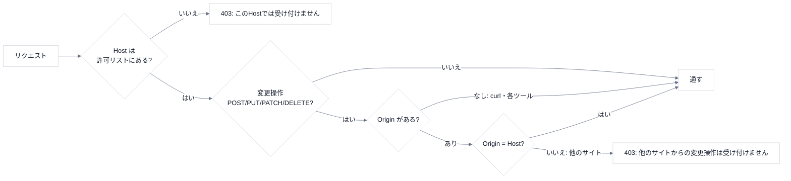

# 第 5 回 Hub 自身を守る: Host・Origin・API キー・役割・監査ログ

> 所要時間の目安: 3.5 時間 / 前提: 第 0〜4 回

## この回のゴール

- Hub が**認証なしのローカル API でも危ない**理由(別サイトからの操作)を説明できる。
- **CSRF** と **DNS rebinding** の違いと、それぞれの対策(Origin 検査・Host 許可リスト)を説明できる。
- API キーを**ハッシュだけ**保存する理由と、`viewer` / `operator` / `admin` の役割の分け方を説明できる。
- **監査ログ**に、何を残し、何を残さないかを説明できる。
- `HUB_AUTH=required` が **fail-closed**(設定ミスで素通しにしない)であることを確かめられる。

## 1. なぜ、ローカルだけの API でも危ないのか

Hub は `127.0.0.1` で待ち受けるので、「自分の PC の中だけ」に見えます。でも、**ブラウザ**は、あなたの PC から、あなたの `127.0.0.1` へ通信できます。
別のサイトを開いただけで、そのページのスクリプトが、Hub を操作できてしまいます。

| 攻撃 | しくみ | Hub への影響 |
|---|---|---|
| **CSRF**(別サイトからの変更操作) | 悪意あるページが、`POST http://127.0.0.1:8790/api/repos/…/sync` を送る。本文の無い単純な POST は、**事前確認(プリフライト)なしで**送られ、実行される | リポジトリの**起動・`git pull`・フォルダ表示**を勝手に実行される |
| **DNS rebinding** | 攻撃者のドメインを、`127.0.0.1` に解決させる。ブラウザは「同じサイト」と信じ、**応答まで読める** | アラートやパスなど、Hub の情報を盗み読まれる |

対策は、**ブラウザが必ず付けるヘッダ**を見るだけです(ブラウザは、ページのスクリプトに、この 2 つのヘッダを**偽らせない**)。



## 2. 実装: `security.py`

```python
# 引用: hub/security.py::install_request_guard
def install_request_guard(app: FastAPI, *, allowed_hosts: frozenset[str]) -> None:
    """全リクエストのHostと、変更操作のOriginを検査するミドルウェアを入れる。"""

    @app.middleware("http")
    async def request_guard(request: Request, call_next):
        host_header = request.headers.get("host", "")
        if host_only(host_header) not in allowed_hosts:
            return JSONResponse(
                status_code=403,
                content={
                    "detail": (
                        f"このHostでは受け付けません: {host_header!r}。"
                        f"127.0.0.1 / localhost 以外のホスト名で開く場合は、環境変数 {ALLOWED_HOSTS_ENV} に追加してください"
                    )
                },
            )
        if request.method in UNSAFE_METHODS:
            origin = request.headers.get("origin")
            if origin is not None and not is_same_origin(origin, host_header):
                return JSONResponse(
                    status_code=403,
                    content={"detail": "他のサイトからの変更操作は受け付けません(Originが一致しません)"},
                )
        return await call_next(request)
```

- **Host の許可リスト**: 既定は `127.0.0.1` / `localhost` / `::1`。DNS rebinding では、Host が攻撃者のドメインになるので、**弾ける**。LAN などで別の名前で開くときは、環境変数 `HUB_ALLOWED_HOSTS` に足す。
- **Origin の一致**: 変更操作で、**Origin ヘッダがあれば、Hub 自身の Host と一致すること**。`Origin: null` と、別ポートのページ(同じ `localhost` でも別オリジン)は弾く。
- **Origin が無いクライアントは通す**: `curl`・各ツールの heartbeat / アラート送信は、**ブラウザではなく**、Origin を付けない。CSRF は**ブラウザ**の問題なので、これで正しい。

> 403 のメッセージが、**直し方**(`HUB_ALLOWED_HOSTS` に追加)まで書いているのは、保守する人(未来の自分)が、迷わないため。

```python
# 実行できる
import os

from hub.security import host_only, is_loopback_host, is_same_origin, resolve_allowed_hosts

os.environ.pop("HUB_ALLOWED_HOSTS", None)  # 環境の影響を受けないように

print("ポートとブラケットを除く:", host_only("[::1]:8790"), "/", host_only("Localhost:8790"))
print("許可リスト(既定):", sorted(resolve_allowed_hosts()))
print("許可リスト(追加):", sorted(resolve_allowed_hosts(["hub.example.test:8790"])))
print("ループバック?", is_loopback_host("127.0.0.1"), is_loopback_host("192.168.0.5"))

host = "127.0.0.1:8790"
for origin in ("http://127.0.0.1:8790", "http://127.0.0.1:5173", "http://evil.example", "null"):
    print(f"Origin {origin:24} → 同じ?", is_same_origin(origin, host))
```

```text
# 出力
ポートとブラケットを除く: ::1 / localhost
許可リスト(既定): ['127.0.0.1', '::1', 'localhost']
許可リスト(追加): ['127.0.0.1', '::1', 'hub.example.test', 'localhost']
ループバック? True False
Origin http://127.0.0.1:8790    → 同じ? True
Origin http://127.0.0.1:5173    → 同じ? False
Origin http://evil.example      → 同じ? False
Origin null                     → 同じ? False
```

注目: `http://127.0.0.1:5173`(同じホストの別ポート)も**弾かれる**。ブラウザは、ポートが違えば別のオリジンとして扱うので、Hub もそれに合わせる。

## 3. 通しで確かめる(TestClient)

FastAPI の `TestClient` で、サーバーを起動せずに、本物のアプリへリクエストを送れます。

```python
# 実行できる
import os
import tempfile

from fastapi.testclient import TestClient

from hub.dashboard.app import create_app

os.environ.pop("HUB_ALLOWED_HOSTS", None)
os.environ["HUB_AUTH"] = "off"

with tempfile.TemporaryDirectory(ignore_cleanup_errors=True) as tmp:
    os.environ["HUB_AUDIT_LOG"] = os.path.join(tmp, "audit.jsonl")
    app = create_app(db_path=os.path.join(tmp, "alerts.sqlite3"))
    client = TestClient(app, base_url="http://127.0.0.1:8790")

    r = client.get("/api/registry")
    print("台帳の取得             :", r.status_code)

    r = client.get("/api/registry", headers={"Host": "evil.example"})
    print("知らない Host           :", r.status_code)

    r = client.post("/api/heartbeat/sound_middleware", headers={"Origin": "http://evil.example"})
    print("別のサイトからの POST   :", r.status_code)

    r = client.post("/api/heartbeat/sound_middleware")  # Origin なし(curl や各ツールと同じ)
    print("Origin なしの POST      :", r.status_code, r.json())

    print("未登録のツール          :", client.post("/api/heartbeat/nothing").status_code)
    print("死活監視の種類が違う    :", client.post("/api/heartbeat/the_algorithm_illustrated").status_code)
```

```text
# 出力
台帳の取得             : 200
知らない Host           : 403
別のサイトからの POST   : 403
Origin なしの POST      : 200 {'tool_id': 'sound_middleware', 'recorded': True}
未登録のツール          : 404
死活監視の種類が違う    : 400
```

最後の 2 行も、設計です: 未登録は **404**、台帳にはあるが `health_check` が違う(CI 系に heartbeat を送った)は **400**。**送り手の勘違いを、静かに受け入れず**、すぐ分かるようにします。

## 4. 認証と役割(v2.7)

既定は**認証なし**(`HUB_AUTH=off`)。複数人で使うときは `HUB_AUTH=required`。

| 役割 | できること |
|---|---|
| `viewer` | **見る**(一覧・アラート・概況・リポジトリの状態) |
| `operator` | viewer + スヌーズ・リポジトリの**起動**・Check all・各ツールからの heartbeat / アラート送信 |
| `admin` | operator + **registry の再読み込み**・**リポジトリの同期(`git pull`)** |

**強い順に包む**(`admin` ⊃ `operator` ⊃ `viewer`)ので、役割は**順位**で比べます。

```python
# 引用: hub/auth.py::role_rank
def role_rank(role: str) -> int:
    return ROLES.index(role) if role in ROLES else -1
```

`ROLES = ("viewer", "operator", "admin")` の**並び順がそのまま順位**。知らない役割は `-1`(どの操作にも足りない = 安全側)。

各ルートは、**必要な最低の役割**を宣言します。

```python
# 抜粋ファイル: hub/dashboard/app.py
@app.get("/api/alerts", dependencies=[auth.viewer])
@app.post("/api/alerts/{alert_id}/snooze", dependencies=[auth.operator])
@app.post("/api/registry/reload", dependencies=[auth.admin])
@app.post("/api/repos/{repo_id}/sync", dependencies=[auth.admin])
```

画面の無効なボタンは**表示だけ**。**権限の判断は常にサーバー側**(403)。ブラウザの画面は、利用者が書き換えられるので、信用しません。

### 4.1 API キーは、ハッシュだけ保存する

```python
# 引用: hub/auth.py::find_by_key
def find_by_key(key: str, users: list[dict]) -> dict | None:
    """全ユーザーを同じ手順で比べる(一致した時点で止めない)。ハッシュ同士の比較は定数時間。"""
    digest = hash_key(key)
    found = None
    for u in users:
        stored = u.get("key_sha256")
        if stored and hmac.compare_digest(stored, digest):
            found = u
    return found
```

- 保存するのは、キーの **SHA-256 ハッシュだけ**(`key_sha256`)。ファイルが漏れても、**元のキーは分からない**(キーは作った**1 度だけ**表示)。
- 比較は `hmac.compare_digest`(**定数時間**)。普通の `==` は、先頭から違う文字で止まるので、**かかる時間の差**から、少しずつ推測される(**タイミング攻撃**)のを防ぐ。
- **全員を比べ終えてから**返す(一致した時点で止めない)。これも、時間の差でユーザーの順番を漏らさないため。

```python
# 実行できる
import os
import tempfile
from pathlib import Path

from hub import auth

with tempfile.TemporaryDirectory(ignore_cleanup_errors=True) as tmp:
    path = Path(tmp) / "users.json"
    key = auth.add_user("alice", "operator", path=path)
    auth.add_user("bob", "viewer", email="bob@example.test", with_key=False, path=path)

    print("キーの形:", key.startswith("hub_"), "/ 長さ", len(key))
    saved = path.read_text(encoding="utf-8")
    print("ファイルにキーそのものが入っているか:", key in saved, "/ ハッシュは入っている:", auth.hash_key(key) in saved)

    users = auth.load_users(path)
    print("正しいキー  →", (auth.find_by_key(key, users) or {}).get("name"))
    print("違うキー    →", auth.find_by_key("hub_wrong", users))
    print("役割の順位  →", {r: auth.role_rank(r) for r in ("viewer", "operator", "admin", "unknown")})
    try:
        auth.add_user("alice", "admin", path=path)
    except ValueError as exc:
        print("名前の重複  →", exc)
    try:
        auth.add_user("carol", "viewer", with_key=False, path=path)
    except ValueError as exc:
        print("キーも email も無い →", exc)
```

```text
# 出力
キーの形: True / 長さ 47
ファイルにキーそのものが入っているか: False / ハッシュは入っている: True
正しいキー  → alice
違うキー    → None
役割の順位  → {'viewer': 0, 'operator': 1, 'admin': 2, 'unknown': -1}
名前の重複  → 'alice' は既にいます。
キーも email も無い → キーを作らないなら、Cloudflare Access 用に --email が要ります。
```

### 4.2 通しで確かめる(役割と 401・403)

```python
# 実行できる
import os
import tempfile
from pathlib import Path

from fastapi.testclient import TestClient

from hub import auth
from hub.dashboard.app import create_app

os.environ.pop("HUB_ALLOWED_HOSTS", None)

with tempfile.TemporaryDirectory(ignore_cleanup_errors=True) as tmp:
    users_file = Path(tmp) / "users.json"
    viewer_key = auth.add_user("v", "viewer", path=users_file)
    operator_key = auth.add_user("o", "operator", path=users_file)
    os.environ.update({"HUB_AUTH": "required", "HUB_AUTH_FILE": str(users_file),
                       "HUB_AUDIT_LOG": os.path.join(tmp, "audit.jsonl")})

    client = TestClient(create_app(db_path=os.path.join(tmp, "alerts.sqlite3")), base_url="http://127.0.0.1:8790")
    send = lambda key: client.post("/api/heartbeat/sound_middleware", headers={"X-API-Key": key} if key else {})

    print("キー無しで読む           :", client.get("/api/registry").status_code)
    print("間違ったキー             :", client.get("/api/registry", headers={"X-API-Key": "hub_wrong"}).status_code)
    print("viewer が読む            :", client.get("/api/registry", headers={"X-API-Key": viewer_key}).status_code)
    print("viewer が heartbeat 送信 :", send(viewer_key).status_code)
    print("operator が heartbeat    :", send(operator_key).status_code)
    print("operator が registry 再読込:", client.post("/api/registry/reload", headers={"X-API-Key": operator_key}).status_code)

    lines = Path(os.environ["HUB_AUDIT_LOG"]).read_text(encoding="utf-8").splitlines()
    print("監査ログの行数:", len(lines))
```

```text
# 出力
キー無しで読む           : 401
間違ったキー             : 401
viewer が読む            : 200
viewer が heartbeat 送信 : 403
operator が heartbeat    : 200
operator が registry 再読込: 403
監査ログの行数: 5
```

- **401**: 誰か分からない(キー無し・間違い)。**403**: 誰かは分かったが、**権限が足りない**。
- 監査ログの 5 行は、拒否の 401 が 2 回・403 が 2 回・成功した POST が 1 回。**成功した読み取り**(viewer の `GET`)は入らない(記録するのは、変更系の操作と、拒否だけ)。

## 5. 監査ログ: 残すもの、残さないもの

`hub/audit.py` は、JSON Lines(1 行 1 件の JSON)で、**変更系の操作・拒否(401・403)・ログイン・ログアウト**を、時刻・名前・役割・方式・パス・結果・IP で残します。

**本文・キー・クッキー・クエリは記録しません**。ログから、秘密(キー)が漏れては、本末転倒だからです。
記録する内容を**最小**にし、「誰が・いつ・何を・どうなったか」だけを残す。admin だけが `GET /api/auth/audit?limit=100` で読めます。

## 6. fail-closed(設定ミスで素通しにしない)

```python
# 引用: hub/auth.py::ensure_auth_configured
def ensure_auth_configured() -> None:
    """required なのに使えるユーザーが居なければ、起動を止める(fail-closed)。"""
    if auth_mode() == "off":
        logger.warning("認証は無効です(%s=off)。複数人で使うなら %s=required にしてください。", AUTH_ENV, AUTH_ENV)
        return
    if not load_users():
        raise RuntimeError(
            f"{AUTH_ENV}=required ですが、ユーザーが 1 人もいません({auth_file()})。"
            "`python -m hub.auth add --name <名前> --role admin` で作ってください。"
        )
```

`HUB_AUTH=required` なのに、ユーザーが 1 人もいない(ファイルの置き場所を間違えた等)とき、**黙って全員を通す**のでなく、**起動を止めます**。「壊れたら、閉じる」(fail-closed)。逆に「壊れたら、開く」(fail-open)は、**気づかないまま**無防備になるので、セキュリティでは避けます。

## 確認問題

1. Hub が `127.0.0.1` だけで待ち受けていても、別のサイトから操作されうるのは、なぜですか。
2. Origin ヘッダが**無い** POST を通すのは、なぜですか。それは危なくありませんか。
3. 同じ `localhost` の別ポート(5173)のページからの POST が弾かれるのは、なぜですか。
4. API キーを、ハッシュだけ保存し、`hmac.compare_digest` で比べるのは、なぜですか。
5. 403 と 401 の違いは。監査ログに、リクエストの本文を残さないのは、なぜですか。

## 解答

1. ブラウザは、あなたの PC から `127.0.0.1` へ通信でき、**別のサイトのスクリプトも、あなたのブラウザから**送れるから(CSRF・DNS rebinding)。
2. Origin を付けないのは、**ブラウザ以外**(curl・各ツール)。CSRF は、**ブラウザが勝手に送る**ことが問題なので、ブラウザは必ず Origin を付け、偽れない。ブラウザ以外の呼び出しを止めるのは、認証(API キー)の役目。
3. ポートが違えば、ブラウザは**別のオリジン**として扱う。別のサービス(開発サーバーなど)のスクリプトが、Hub を操作できないようにする。
4. ファイルが漏れても、元のキーが分からないように(ハッシュ)。普通の比較は、違う位置で止まるので、**時間の差から推測される**(タイミング攻撃)のを防ぐ(定数時間の比較)。
5. 401: 誰か分からない(認証されていない)。403: 誰かは分かったが、**権限が足りない**。本文を残さないのは、**キーなどの秘密がログに残らない**ようにするため。

## まとめ

- ローカルの API でも、**ブラウザ経由**で攻撃される(CSRF・DNS rebinding)。**Host の許可リスト**と**Origin の一致**で守る。
- 認証は、API キー(ハッシュだけ保存・定数時間で比較)と、`viewer < operator < admin` の役割。判断は**常にサーバー側**。
- 監査ログは最小限(本文・キー・クッキーは残さない)。`required` でユーザーがいなければ**起動しない**(fail-closed)。
- 次の回(最終回)は、テストの書き方と、新しい送り手を足す総合演習。
