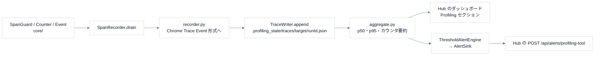

# 第 6 回 テスト・計測のサブ機能・総合演習

> 所要時間の目安: 半日 / 前提: 第 0〜5 回

## この回のゴール

- このリポジトリの**テストの置き方**(何をどこで確かめるか)が分かる。
- 重い・外へ出る処理(git・通知・ネットワーク)を**避けて**テストする書き方が分かる。
- サブ機能 `profiling_tool` の**データの流れ**(span → Chrome Trace → 集計)を、手で動かして説明できる。
- 新しい**送り手**(アラートの発生元)を、Hub に足す手順を、自分で実行できる。

## 1. 今あるテスト

`uv run pytest -q` で全部が走ります(Hub 本体 + `profiling_tool`)。主なもの:

| ファイル | 確かめるもの |
|---|---|
| `tests/test_registry.py` | 台帳の読み込み・検証・循環・ホットリロード |
| `tests/test_health_checks.py`・`test_runner.py` | 3 種の死活監視・`LivenessMonitor` の間引きと「信号なし」 |
| `tests/test_alert_aggregator.py`・`test_alert_store.py` | dedup・再発・解消・スヌーズ・SQLite の保存と移行 |
| `tests/test_tool_state.py`・`test_overview.py` | 状態の判定・概況・履歴の再現 |
| `tests/test_security.py`・`test_auth.py`・`test_admin_split.py` | Host・Origin・役割・監査・`/admin` の分離 |
| `tests/test_dashboard_*.py` | 画面と API(`TestClient`) |
| `tests/test_repo_sync.py`・`test_process_launcher.py` | git の同期・起動(**本物の git・本物の起動はしない**) |
| `tests/profiling_tool/` | 計測基盤(span・counter・集計・アラート) |
| `tests/test_docs.py` | この文書(引用・実行例・リンク・図) |

## 2. 外へ出る処理を避けるテストの書き方

Hub には、**外に影響する**処理があります(`git fetch`・`git pull`・新しい窓でのコマンド起動・Windows のトースト・Slack 送信)。テストが**本物を動かさない**ための工夫:

- **差し替え**: `monkeypatch`(pytest)で、本物の関数を偽物に替える。
- **フィクスチャ**: `tests/conftest.py` の `no_real_repo_sync` は、`RepoRegistry.load` を替えて、`create_app()` が**本物の 14 リポジトリへ `git fetch` しない**ようにする(起動時に 1 回走るため、何もしないと遅く、ネットワーク頼みになる)。
- **時刻を引数に**: `is_open_at(at)`・`record_heartbeat(at=...)`・`check_once(now=...)`(能動の間引き)のように、**時刻を引数で受ける**設計にして、`sleep` せずに「30 秒後」を再現する(第 2・3 回で使った。ただし `rpc_check` の内部は `now` を受けない。第 2 回の注意)。
- **一時フォルダ**: `tmp_path` / `tempfile` で、本物のファイルを壊さない。
- **`TestClient`**: サーバーを起動せず、アプリへ直接リクエストを送る(第 5 回)。

```python
# 抜粋ファイル: tests/conftest.py
def no_real_repo_sync(monkeypatch):
    original_load = RepoRegistry.load.__func__
    def _load(cls, path=None):
    monkeypatch.setattr(RepoRegistry, "load", classmethod(_load))
```

> **テストの名前は、挙動の文**にする(`test_upsert_alert_does_not_overwrite_first_seen_at` のように)。落ちたときに、何が壊れたかが、名前だけで分かる。

## 3. サブ機能 `profiling_tool`: 計測 → トレース → 集計

`profiling_tool/` は、ツールの処理時間(span)・数値(counter)・出来事(event)を**記録**し、Chrome の**トレース形式**(JSON)で保存し、**集計**してダッシュボードに出す、計測基盤です。



- **`with SpanGuard(...)`**: `with` を抜けると**自動で終了**を記録する(RAII。書き忘れない)。入れ子にすると、**親子**が自動で付く(スレッドごとのスタック)。
- **Chrome Trace Event 形式**: `chrome://tracing` や Perfetto で、そのまま開ける。**既存のビューアが使える**のが利点。
- **集計は純関数**(JSON → JSON): 表示から切り離し、単体でテストできる。

```python
# 実行できる
from profiling_tool.aggregate import counter_summary, list_span_names, percentile_by_span_name
from profiling_tool.core.recorder import spans_to_events
from profiling_tool.core.span import Span, SpanGuard, SpanRecorder

recorder = SpanRecorder()
# 時刻を固定して、決まった入れ子を記録する(μ 秒)
outer = recorder.begin("frame", at_us=0)
inner = recorder.begin("decode", at_us=100)
recorder.end(inner, at_us=400)
recorder.end(outer, at_us=1000)

spans = recorder.drain()
for s in spans:
    parent = s.parent.name if s.parent else "(なし)"
    print(f"{s.name:7} 長さ {s.duration_us:4d}μs  親: {parent}")
print("drain 後は空:", recorder.drain())

# 集計: frame を 5 回測った結果から p50 / p95
events = []
for i, dur in enumerate([900, 1000, 1100, 1200, 3000]):
    events += spans_to_events([Span(name="frame", start_us=i * 10000, end_us=i * 10000 + dur)])
print("span の名前:", list_span_names(events))
print("p50:", percentile_by_span_name(events, "frame", 0.50), "μs / p95:", percentile_by_span_name(events, "frame", 0.95), "μs")

# with 文(SpanGuard)なら、抜けたときに自動で終わる
with SpanGuard(recorder, "guarded") as span:
    print("with の中: 未終了?", span.is_open)
print("with の後 : 未終了?", span.is_open)
```

```text
# 出力
decode  長さ  300μs  親: frame
frame   長さ 1000μs  親: (なし)
drain 後は空: []
span の名前: ['frame']
p50: 1100 μs / p95: 3000 μs
with の中: 未終了? True
with の後 : 未終了? False
```

- **p50(中央値)**は典型的な値、**p95** は「ほとんどの場合の上限」。平均は外れ値(3000μs)に**引っ張られる**ので、遅さの把握には**パーセンタイル**を使う。
- 計算は「`int(件数 × p)` 番目」(**最近傍順位**)。件数が少ないと、p50 が上側の値になる(5 件なら 3 番目)。厳密な補間(線形補間)ではない — **仕様として知っておく**。

### 既知の制約(コードは変えていない)

- `TraceWriter.append` は、**毎回ファイル全体を読み、全体を書き直す**。同じ run に何度も追記すると、イベント数に対して**遅くなる**(runId ごとにファイルを分けているので、実用上は小さい範囲)。
- ダッシュボードは、`profiling_tool` 側の不具合で Hub 本体が落ちないよう、**例外を握りつぶして**います(安全側)が、握りつぶすので**原因がログに残りにくい**。

## 4. 総合演習: 新しい送り手を足す

**課題**: ビルドサーバー(`build_server`)が、ビルドの失敗をアラートとして Hub に送れるようにしたい。**既存の 4 つの送り手と同じ形**(`normalize_from_*` → `AlertAggregator`)で作ります。

手順(`learn/04-extend.md` の「送り手を足す」と同じ):

1. **正規化関数**を書く(署名 = ジョブ名、失敗 = `critical`、成功 = `info` =解消の信号)。
2. **受け口**(`POST /api/alerts/build-server`)を足す(`_normalize_and_ingest` を使い回す)。
3. **台帳**に載せる(`registry.yaml`)。載せなくても動くが、画面でツールに紐づかない。
4. **テスト**を書く。

```python
# 実行できる
from datetime import datetime, timezone

from hub.alert_aggregator import AlertAggregator, AlertRecord, Severity, _make_alert_id


def normalize_from_build_server(raw: dict) -> AlertRecord:
    """ビルドサーバーの 1 件の結果({"job": ..., "ok": bool, "log_tail": ...})を、AlertRecord にする。"""
    tool_id = "build_server"
    job = raw.get("job", "unknown")
    failed = not raw.get("ok", True)
    return AlertRecord(
        alert_id=_make_alert_id(tool_id, str(job)),
        source_tool_id=tool_id,
        severity=Severity.CRITICAL if failed else Severity.INFO,
        message=raw.get("log_tail") or f"build {job}: {'failed' if failed else 'passed'}",
        first_seen_at=datetime.now(timezone.utc),
    )


opened = []
agg = AlertAggregator(on_open=lambda a: opened.append(a.message))


def receive(raw):  # app.py の _normalize_and_ingest と同じ流れ
    alert = normalize_from_build_server(raw)
    if alert.severity is Severity.INFO:
        return "resolved" if agg.resolve_by_id(alert.alert_id) else "nothing"
    agg.ingest(alert)
    return "ingested"


print(receive({"job": "nightly", "ok": False, "log_tail": "link error in game.exe"}))
print(receive({"job": "nightly", "ok": False, "log_tail": "link error in game.exe"}))   # もう一度: dedup
print("open:", len(agg.open_alerts()), "/ 通知:", opened)
print(receive({"job": "nightly", "ok": True}))
print("open:", len(agg.open_alerts()), "/ resolved:", len(agg.resolved_alerts()))
print(receive({"job": "other", "ok": True}))  # 失敗が無いジョブの成功
```

```text
# 出力
ingested
ingested
open: 1 / 通知: ['link error in game.exe']
resolved
open: 0 / resolved: 1
nothing
```

次に、これを**テスト**にします(pytest の関数の形。この文書では実行しません)。

```python
def test_build_server_failure_is_deduped_and_resolved_by_success():
    agg = AlertAggregator()
    agg.ingest(normalize_from_build_server({"job": "nightly", "ok": False}))
    agg.ingest(normalize_from_build_server({"job": "nightly", "ok": False}))
    assert len(agg.open_alerts()) == 1                       # 1 件にまとまる
    agg.resolve_by_id(normalize_from_build_server({"job": "nightly", "ok": True}).alert_id)
    assert agg.open_alerts() == []                           # 成功で解消
```

### 自分で拡張する課題

1. `normalize_from_build_server` に、**ジョブ名が空のとき `400` になる**ように、検査を足す(既存の `_normalize_and_ingest` は `ValueError`・`KeyError`・`TypeError` を 400 に変える)。
2. `hub/runbooks.yaml` に、`build_server` 用の**対応手順**(やること・やらないこと)を足す(`KIND_*` の追加と、`runbooks.py` の分類の変更が要る)。
3. 成功が 3 回続いたら**だけ**解消にする(フラッピング対策)。どこに状態を持つべきか、考える(ヒント: `AlertAggregator`・メモリか SQLite か)。

## 確認問題

1. テストが、本物の `git fetch` や Windows トーストを動かさないのは、なぜですか。どう避けていますか。
2. `is_open_at(at)` や `record_heartbeat(at=...)` のように、時刻を**引数で受け取る**と、テストでどう嬉しいですか。
3. 平均でなく p95 を使うのは、なぜですか。
4. 新しい送り手を足すとき、`severity` の `info` に、どんな意味を持たせますか。
5. 総合演習の `normalize_from_build_server` が、`_make_alert_id`(先頭が `_`)を使うのは、何が気になりますか。

## 解答

1. 遅い・ネットワーク頼み・他のプロジェクトのファイルを書き換えうるから。`monkeypatch` や `conftest.py` のフィクスチャで、本物を偽物に替える。
2. `sleep` で本当に待たずに、「30 秒後」「25 秒前」を、**一瞬で・決まった結果で**再現できる(テストが速く、不安定にならない)。
3. 平均は、外れ値に引っ張られ、**遅い瞬間**を隠す。p95 は、「ほとんどの場合の上限」を表す。
4. 「**解消した**」という信号。同じ署名の open アラートを resolved にする。
5. `_` で始まる名前は**内部用**で、変更されうる(公開の約束ではない)。本物に入れるなら、`alert_aggregator.py` の中に置くか、公開の関数にする。

## まとめ

- テストは、**挙動の文の名前**で、外へ出る処理は差し替え、時刻は引数で受ける。
- `profiling_tool` は、span → Chrome Trace → 純関数の集計。遅さは**パーセンタイル**で見る。
- 新しい送り手は、**正規化 → 受け口 → 台帳 → テスト**。`info` が「解消」の信号。
- ここから先は、[学習資料](../learn/index.md)(保守・拡張の実務編)へ。
